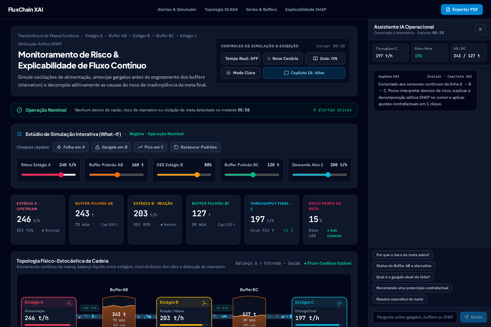
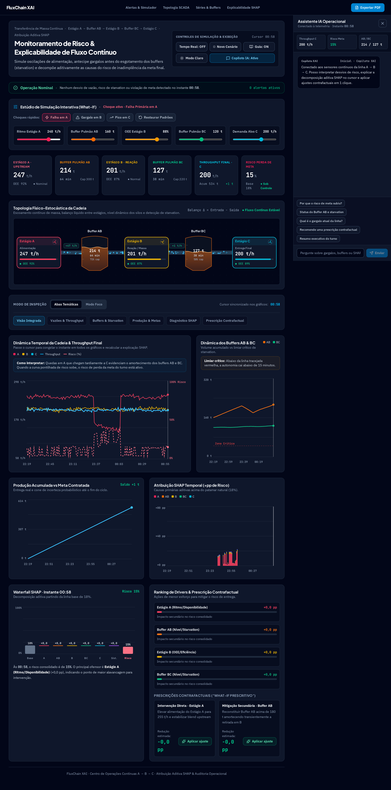
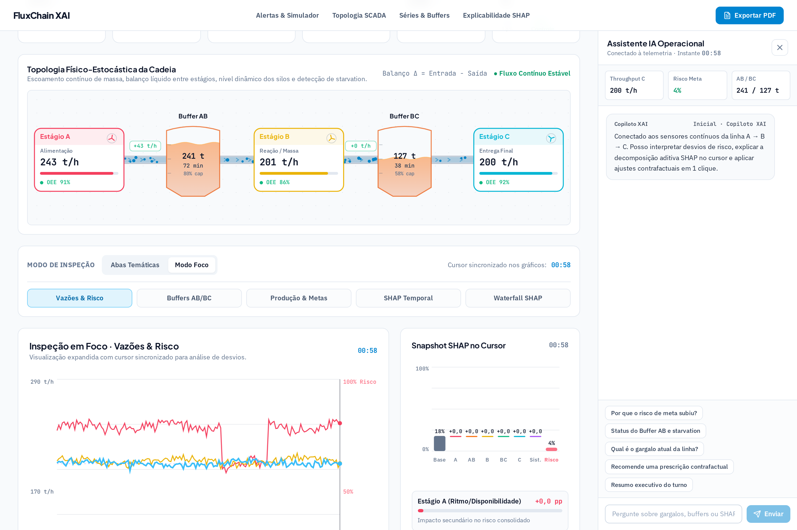
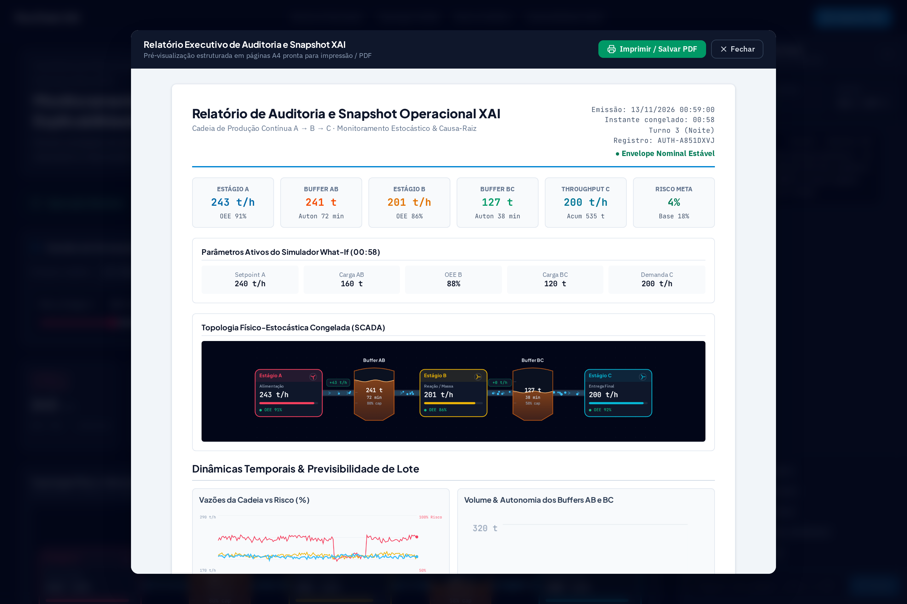

# FluxChain XAI — Cadeia de Produção Contínua A → B → C

Painel industrial interativo para monitoramento e simulação estocástica da dinâmica de transferência de massa em tempo contínuo ao longo de uma linha seriada (**Estágio A → Buffer AB → Estágio B → Buffer BC → Estágio C**). O motor calcula dinamicamente o **Risco Consolidado de Inadimplência da Meta Final** e decompõe aditivamente suas causas primárias com explicabilidade **SHAP**, permitindo intervenção preventiva antes que o esgotamento dos buffers (*starvation*) comprometa a entrega final.

---

## Snapshots da Aplicação

### 1. Visão Integrada, Topologia SCADA e Copiloto IA (Modo Escuro)
Visão principal com controles de simulação, KPIs instantâneos, diagrama SCADA animado (silos com nível dinâmico, ondas de massa, rotores e balanço líquido Δ entre estágios), séries temporais sincronizadas e assistente operacional conectado à telemetria.



---

### 2. Alertas Visuais em Tempo Real, SHAP & Prescrição Contrafactual
Detecção automática de desvios críticos (*starvation*, queda de autonomia abaixo de 15 min e risco elevado) com decomposição aditiva SHAP (temporal + waterfall) e recomendações contrafactuais acionáveis em 1 clique.



---

### 3. Modo Foco & Tema Claro
Modo de inspeção profunda para análise ampliada de qualquer série temporal ou gráfico Waterfall lado a lado com o ranking de ofensores SHAP no instante congelado pelo cursor.



---

### 4. Relatório Executivo e Snapshot de Auditoria (PDF)
Exportação estruturada em múltiplas páginas A4 contendo cabeçalho de turno, KPIs congelados, parâmetros ativos do simulador What-If, captura da topologia SCADA, gráficos analíticos, tabela ponderada SHAP e registro de auditoria.



---

## Arquitetura e Funcionalidades

- **Simulação Estocástica Contínua (`src/engine/processSimulation.ts`)**:
  - Modela o fluxo de massa em t/h ao longo de 160 pontos temporais (com streaming em **Tempo Real** opcional a cada `1,2s`), acumulando e drenando os pulmões `AB` (capacidade `300 t`) e `BC` (capacidade `220 t`).
  - Calcula autonomia em minutos, detecta condições de *starvation* nos estágios B e C e gera projeção acumulada com cone de incerteza contra a meta de `200 t/h`.
- **Explicabilidade SHAP & Prescrições (`src/components/XaiDiagnostics.tsx`, `src/components/ProcessCharts.tsx`)**:
  - Atribui de forma aditiva o desvio de risco acima do baseline (`18%`) entre os drivers `Estágio A`, `Buffer AB`, `Estágio B`, `Buffer BC`, `Estágio C` e `Instabilidade Sistêmica`.
  - Cursor interativo sincronizado em todos os gráficos para congelar qualquer instante e inspecionar o **Waterfall SHAP** e o ranking de ofensores.
- **Alertas em Tempo Real (`src/components/AlertsBanner.tsx`)**:
  - Exibe alertas dinâmicos de severidade (`Crítico` / `Atenção`) com métricas em fonte tabular e botões diretos de mitigação (`Rebalancear Buffers` ou `Aplicar Ajuste Prescrito`).
- **Estúdio What-If (`src/components/WhatIfStudio.tsx`)**:
  - Ajuste em tempo real dos setpoints de alimentação em A, carga dos buffers AB/BC, OEE do estágio B e demanda alvo em C, além de injeção de choques rápidos (`Falha em A`, `Gargalo em B`, `Pico em C`).
- **Copiloto IA Operacional (`server.ts`, `src/components/AiAssistantDock.tsx`)**:
  - Endpoint server-side `POST /api/assistant` integrado ao `@google/genai` (`gemini-4-hydrogen`) com fallback determinístico local caso `GEMINI_API_KEY` não esteja configurada.
- **Topologia SCADA em Canvas (`src/components/ScadaFlowCanvas.tsx`)**:
  - Renderização High-DPI com partículas de escoamento, setas direcionais nos dutos, balanço líquido de massa (`Δ = Entrada − Saída`), rotores animados e silos industriais graduados.

---

## Stack Tecnológica

- **Frontend**: React 19, TypeScript, Tailwind CSS v4, Lucide Icons, HTML5 Canvas High-DPI
- **Backend**: Node.js, Express, `@google/genai` (Gemini API server-side)
- **Build & Tooling**: Vite 8, `tsx`

---

## Como Executar Localmente

1. **Instale as dependências**:
   ```bash
   npm install
   ```

2. **Configure as variáveis de ambiente** (opcional para respostas generativas no Copiloto IA):
   ```bash
   cp .env.example .env
   # Defina GEMINI_API_KEY no arquivo .env (sem chave, o copiloto usa o motor XAI local)
   ```

3. **Inicie o servidor de desenvolvimento** (porta `3000`):
   ```bash
   npm run dev
   ```

4. **Verifique tipagem e build de produção**:
   ```bash
   npm run lint
   npm run build
   npm start
   ```
